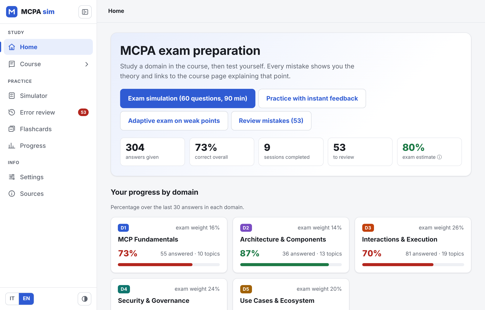
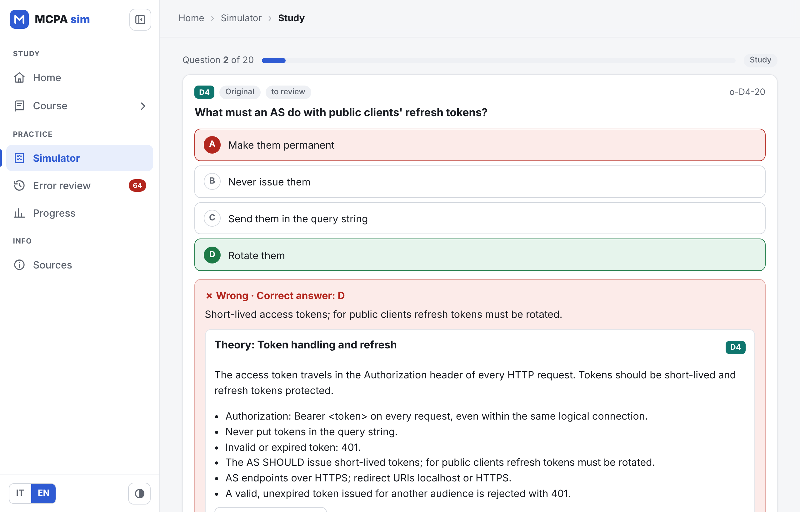
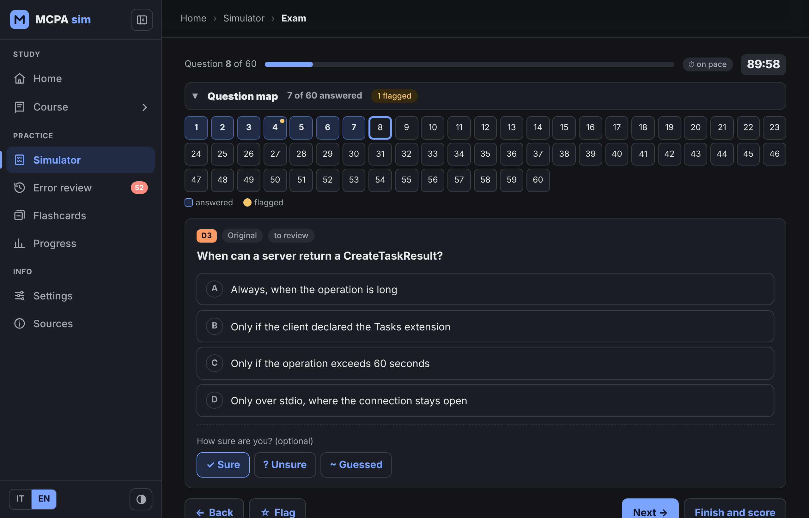
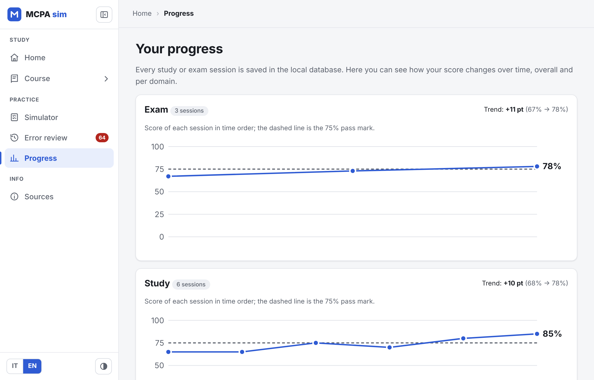
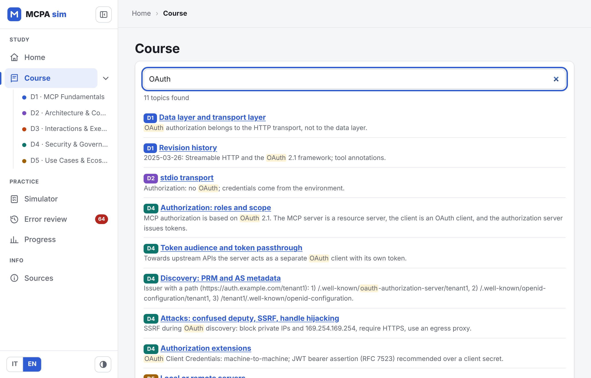
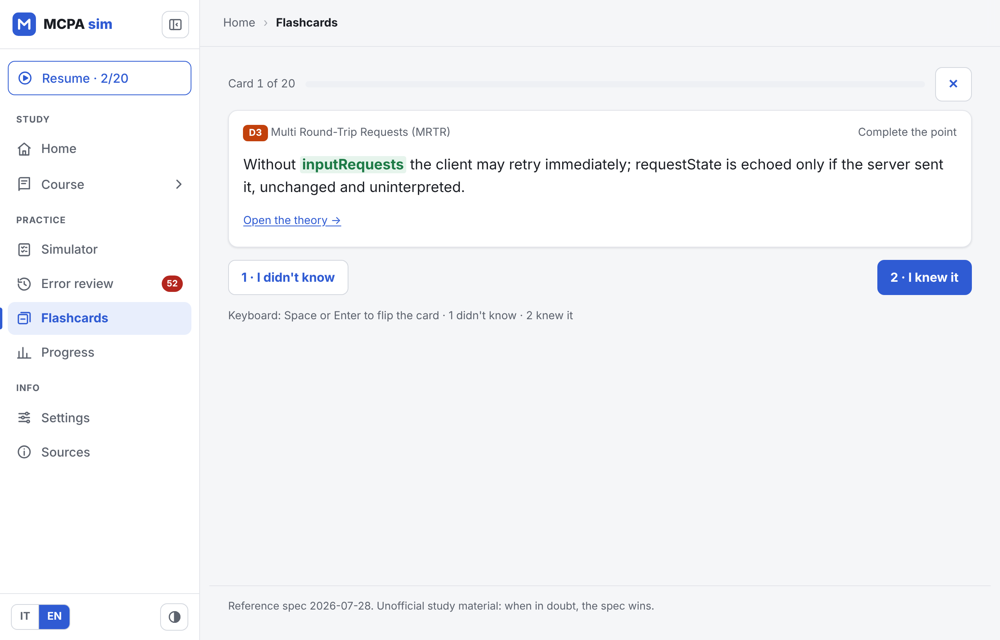
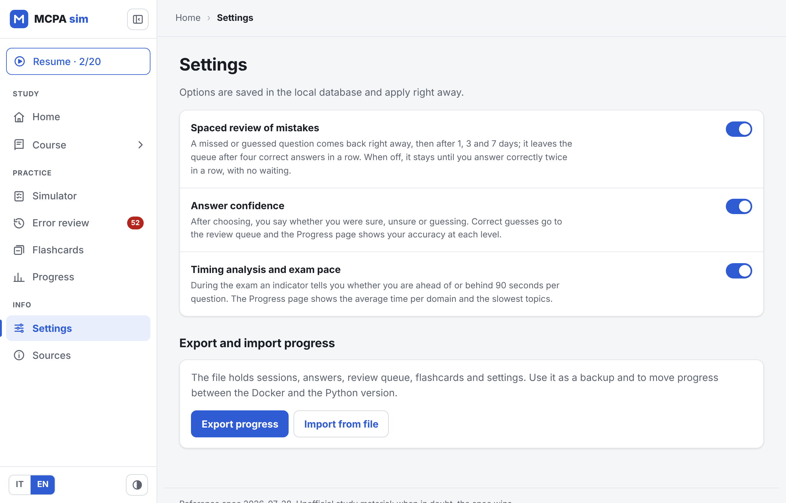

# MCPA Simulator — preparazione all'esame Model Context Protocol Associate

[English](README.md) · **Italiano**

    

Progetto di studio per l'esame **MCPA (Model Context Protocol Associate)** della Linux Foundation / Agentic AI Foundation, allineato alla specifica **MCP 2026-07-28**.

Contiene tre cose:

1. una **base di conoscenza** costruita solo su fonti ufficiali (spec, documentazione, SEP, pagine d'esame LF);
2. un **corso** in italiano e inglese, diviso per i 5 domini d'esame;
3. un **simulatore d'esame** web locale con 672 domande, prove a tempo, ripasso degli errori e storico dei progressi su SQLite.

> Materiale di studio **non ufficiale**, non affiliato a Linux Foundation, AAIF o Anthropic. In caso di dubbio vale la spec. Nessuna domanda d'esame reale o "dump" è stata cercata o usata: lo vieta il LF Certification & Confidentiality Agreement.



---

## Avvio rapido

### Con Docker (consigliato)
Serve Docker Desktop (Windows/macOS) o Docker Engine (Linux).

```bash
cd site
docker compose up -d --build
```
Poi apri **http://localhost:8765/**. Su Windows basta il doppio clic su `site/avvia-docker.bat`.

- Il database sta nel volume `mcpa-data`: sessioni e progressi restano anche se ricrei il container.
- La porta è pubblicata solo su `127.0.0.1`, quindi il sito non è raggiungibile dalla rete.
- Per fermarlo: `docker compose down`. Con `docker compose down -v` cancelli anche i progressi.
- Dopo un aggiornamento delle domande: `docker compose up -d --build`.

### Senza Docker
Serve solo **Python 3.8+**, senza librerie aggiuntive.

```bash
python site/server.py          # apre il browser su http://127.0.0.1:8765
```
Su Windows: doppio clic su `site/avvia.bat`. Il database è `site/mcpa.db`, separato da quello di Docker.

### Primo avvio dopo un `git clone`
Il database non è nel repository: al primo avvio `server.py` fa tutto da solo.
1. Crea il database se non esiste.
2. Applica le **migrazioni** `site/migrations/NNNN_*.sql` non ancora registrate nella tabella `schema_migrations`.
3. Importa corso e domande da `site/bank.json`. Lo reimporta solo quando cambia, senza toccare sessioni e risposte.

Per preparare il database senza aprire il sito: `python site/server.py --migrate`.

---

## L'esame in breve
| | |
|---|---|
| Formato | multiple-choice, online, proctored (PSI), una retake inclusa |
| Durata | **90 minuti** (pagina ufficiale MCPA) |
| Domande / soglia | non pubblicate per MCPA; le regole LF generiche per gli esami MC sono **60 domande, 75%** |
| Regole | closed book, PSI Secure Browser, esito pass/fail via email entro 24 ore |
| Prezzo / validità | 250 USD; certificazione valida 2 anni, eligibility 12 mesi |
| Domini | Interactions & Execution **26%** · Security & Governance **24%** · Use Cases & Ecosystem **20%** · MCP Fundamentals **16%** · Architecture & Components **14%** |

Dettagli e fonti: [`sources/exam/lf-exam-page.md`](sources/exam/lf-exam-page.md).

---

## Il simulatore (`site/`)

### Funzioni
- **Corso:** 5 domini, 75 topic, ognuno con sintesi, punti chiave, trappole tipiche, link alla fonte ufficiale e domande di verifica. Ogni dominio mostra anche gli obiettivi del curriculum rohitg00, segnalati come non ufficiali.
- **Simulatore**, con due modalità:
  - **esame:** 60 domande in 90 minuti, distribuite per peso di dominio, correzione alla fine, soglia 75%;
  - **studio:** feedback immediato. Quando sbagli compare la teoria del topic, con il link alla pagina di spiegazione.
- **Filtri:** set di domande (originali, difficili, rohitg00, Hugging Face, tutte), difficoltà e domini.
- **Ripasso dilazionato:** le domande sbagliate o tirate a indovinare tornano oggi, poi dopo 1, 3 e 7 giorni, ed escono dopo quattro risposte giuste di fila (due, se il ripasso dilazionato è disattivato).
- **Confidenza:** dopo ogni risposta indichi se eri sicuro, in dubbio o se hai tirato a indovinare. Le risposte giuste ma indovinate vanno comunque nel ripasso.
- **Tempi e ritmo:** durante l'esame un indicatore dice quanto sei in anticipo o in ritardo rispetto a 90 secondi per domanda.
- **Esame adattivo:** 60 domande con la distribuzione ufficiale per dominio, scelte tra quelle da ripassare, sbagliate di recente, mai viste e degli argomenti più deboli.
- **Flashcard:** 200 carte generate dai punti del corso (codici di errore, header, metodi, campi, RFC, MUST/SHOULD/MAY), a partire dai punti deboli, con ripetizione a scatole (Leitner).
- **Impostazioni:** ripasso dilazionato, confidenza, analisi dei tempi e domande a risposta multipla nelle prove d'esame si possono disattivare (di default sono attivi; le pagine pubbliche LF non dicono se l'esame vero ha domande a risposta multipla). Da qui si esportano e importano i progressi in un file JSON, utile anche per passare da Docker a Python e viceversa.
- **Progressi:**
  - andamento nel tempo di esami e sessioni di studio, con la linea del 75%;
  - trend per dominio e topic più deboli;
  - precisione per livello di confidenza, tempo medio per dominio e argomenti più lenti;
  - dettaglio di ogni sessione, con tempo e confidenza per domanda.
- **Lingue:** interfaccia, corso e domande originali in **italiano e inglese**, con cambio lingua in alto a destra. I termini tecnici e i nomi dei metodi della spec restano in inglese.
- **Interfaccia:**
  - tema chiaro, scuro o automatico, con il pulsante in alto a destra;
  - tastiera durante le prove: A–D o 1–4 per rispondere, Invio per confermare o andare avanti, ← → per spostarsi, F per segnare una domanda;
  - mappa delle domande nell'esame, con risposte date e domande segnate, e conferma prima della consegna;
  - la sessione in corso resta salvata nel browser: se ricarichi la pagina riprendi da dove eri, timer compreso;
  - avvio rapido (esame completo, 10 domande, solo Security & Governance, solo difficili) e numero di domande disponibili con i filtri scelti;
  - ricerca tra i 75 topic del corso;
  - stima d'esame in home, pesata con i pesi ufficiali dei domini;
  - layout adatto a telefono e tablet.
- **Risposta multipla:** 73 domande chiedono di selezionarne più di una e lo indicano sempre ("scegli N"). Vale solo la combinazione esatta.

### Schermate
| Feedback in modalità studio | Esame (tema scuro) |
|---|---|
|  |  |
| **Progressi** | **Ricerca nel corso** |
|  |  |
| **Flashcard** | **Impostazioni ed esportazione** |
|  |  |

### Domande (672)
| Set | Numero | Lingua | Licenza / origine |
|---|---|---|---|
| Originali | 154 | IT + EN | questo progetto |
| Difficili (scenari, 18 a risposta multipla) | 50 | IT + EN | questo progetto |
| Lacune di copertura (fatti della spec non ancora coperti, 8 a risposta multipla) | 31 | IT + EN | questo progetto |
| rohitg00 / ai-engineering-from-scratch | 414 | EN | MIT: 34 quiz di lezione, diagnostico, 3 mock da 60 |
| Hugging Face MCP course | 23 | EN | Apache 2.0, precedenti alla 2026-07-28 ed esclusi dalle prove d'esame |

Puoi aggiungere domande tue in `site/local/questions-*.json`: la cartella è esclusa da git, il simulatore le carica all'avvio e non finiscono nel repository pubblico (vedi `site/local/README.md`).

Le domande esterne sono state revisionate sulla spec. Le correzioni sono segnalate nell'interfaccia con lo stato "corretta" e documentate in `site/REVISIONE-domande.md` e `site/REVISIONE-lezioni.md`.

### Architettura
```
browser ──HTTP──► server.py (Python standard library: http.server + sqlite3)
                     ├── file statici: index.html, app.js, app.css
                     ├── API JSON:  GET  /api/data, /api/stats, /api/sessions/{id}
                     │              POST /api/sessions, /api/answers,
                     │                   /api/sessions/{id}/finish, /api/sessions/{id}/delete
                     └── SQLite: mcpa.db (o /data/mcpa.db in Docker)
```
- **Frontend:** single-page app in JavaScript vanilla, senza build né dipendenze. I grafici sono SVG generati a mano.
- **Backend:** `server.py`, solo libreria standard. Ascolta su `127.0.0.1` e controlla gli header `Host` e `Origin` contro il DNS rebinding. La correttezza delle risposte è calcolata dal server.
- **Database:** tabelle `domains`, `topics`, `questions`, `options` (contenuti) e `sessions`, `session_questions`, `answers`, `review_queue`, `flashcards`, `settings` (progressi), più `meta` e `schema_migrations`.
- **Configurazione tramite variabili d'ambiente:** `MCPA_PORT` (default 8765), `MCPA_BIND` (default 127.0.0.1; `0.0.0.0` in Docker), `MCPA_DB` (percorso del database), `MCPA_NO_BROWSER`; per una copia online privata `MCPA_PASSWORD` (attiva il login) e `MCPA_PUBLIC_HOST`.
- **Online solo per te (facoltativo):** deploy protetto da password su Fly.io (`site/fly.toml`) o Render gratuito (`render.yaml`, tenuto sveglio da UptimeRobot su `/healthz`; i progressi si salvano con esporta/importa). Guida passo passo in [`DEPLOY.md`](DEPLOY.md). In locale resta senza password.

### Contenuti e pipeline di build
```
site/content/course-D1..D5.json      corso IT/EN (topic, punti, trappole, fonti)
site/content/questions-D1..D5.json   domande originali
site/content/questions-hard.json     domande difficili (generate da build/gen_hard.py)
site/local/                          domande personali, escluse da git (vedi site/local/README.md)
practice-questions/open-licensed/    domande rohitg00 (MIT) e Hugging Face (Apache 2.0)
        │
        ▼  python site/build/build_data.py
site/bank.json                       banco unico versionato, importato nel DB all'avvio
```
Script in `site/build/`:

| Script | Cosa fa |
|---|---|
| `build_data.py` | Unisce corso e domande in `bank.json`. Collega le domande esterne ai topic con TF-IDF, eccezioni manuali in `topic_overrides.json`, ed errata delle domande rohitg00. |
| `gen_hard.py` | Rigenera `content/questions-hard.json`. |
| `review_fixes.py` | Correzioni idempotenti alle domande originali. |
| `lesson_points.py` | Punti di teoria aggiunti dalle 34 lezioni rohitg00, verificati sulla spec. |
| `check_consistency.py` | Controlli di coerenza: struttura delle domande, IT/EN, `content/` → `bank.json` → database creato da zero. Esce con codice 1 se trova errori. |

Flusso tipico dopo una modifica ai contenuti:
```bash
python site/build/build_data.py && python site/build/check_consistency.py
```

### Migrazioni del database
Per cambiare lo schema si aggiunge un file `site/migrations/0003_descrizione.sql`, con il numero successivo. Ogni migrazione gira in una transazione e viene registrata in `schema_migrations`. Le migrazioni già pubblicate non vanno modificate.

---

## Base di conoscenza
```
knowledge/manifest.json   indice macchina: domini → competenze LF → topic → fatti chiave → fonti
notes/                    dispense in italiano (termini tecnici in inglese)
  01..05-*.md             una per dominio; la 04 (Security & Governance) è la più approfondita
  10-novita-2026-07-28.md differenze rispetto alla 2025-11-25, con le SEP
  11-cheatsheet-jsonrpc.md metodi, notifiche, errori, header, _meta
  12-glossario.md, 13-trappole-e-ambiguita.md, 14-copertura-domini.md
sources/                  copie delle fonti ufficiali (vedi sources/SOURCES.md)
  spec-2026-07-28/        spec di riferimento completa + schema.ts + schema.json
  spec-2025-11-25/        spec precedente, per i confronti
  docs/ extensions/ registry/ community/ seps/ blog/ exam/
practice-questions/       domande gratuite non ufficiali: open-licensed/ copiate con licenza, catalogo-fonti/ solo schede
question-bank/            schema JSON delle domande (question.schema.json)
```
Le copie in `sources/` vengono dal commit `862397c` del repository `modelcontextprotocol/modelcontextprotocol`. Il 2026-11-22 sono state confrontate con il repository online e sono risultate identiche: 175 file su 175 (vedi `site/VERIFICA-2026-11-22.md`).

### Come studiare
1. Leggi `notes/10-novita-2026-07-28.md`: la 2026-07-28 cambia le basi (stateless, MRTR, niente sessioni né initialize).
2. Segui il corso nel sito in ordine di peso: D3 → D4 → D5 → D1 → D2.
3. Usa la modalità studio per topic, poi il diagnostico e i mock in modalità esame.
4. Controlla i grafici in **Progressi** e lavora sui topic più deboli e sul ripasso errori.

---

## Regole del progetto
- Solo **fonti ufficiali** come base. I siti non ufficiali servono solo come mappa degli argomenti, e ogni affermazione è verificata sulla spec.
- Nessuna domanda d'esame reale e nessun dump.
- Le domande di terzi protette da copyright non vengono copiate: si fanno solo schede riassuntive in `practice-questions/catalogo-fonti/`.
- In caso di contrasto vale la spec **2026-07-28**.

## Contribuire
Segnalazioni di domande sbagliate e proposte sono benvenute: vedi [`CONTRIBUTING.md`](CONTRIBUTING.md). Ogni correzione deve citare la spec 2026-07-28.

## Licenza
Il codice e i contenuti originali di questo progetto (sito, script, corso, domande originali, dispense) sono rilasciati sotto **licenza MIT**: vedi [`LICENSE`](LICENSE).

Il materiale di terze parti incluso mantiene la propria licenza:

| Percorso | Origine | Licenza |
|---|---|---|
| `sources/spec-*`, `sources/seps/`, `sources/extensions/`, `sources/registry/`, `sources/community/`, `sources/docs/`, `sources/blog/` | progetto Model Context Protocol (`modelcontextprotocol/modelcontextprotocol`) | specifiche e codice Apache 2.0; documentazione CC BY 4.0 |
| `practice-questions/open-licensed/rohitg00-mcpa/` | rohitg00/ai-engineering-from-scratch | MIT (vedi `LICENSE` e `ATTRIBUTION.md` nella cartella) |
| `practice-questions/open-licensed/huggingface-mcp-course/` | huggingface/mcp-course | Apache 2.0 (vedi `LICENSE` e `ATTRIBUTION.md` nella cartella) |
| `sources/exam/` | sintesi parafrasate delle pagine pubbliche Linux Foundation / AAIF | i diritti sulle pagine originali restano ai titolari |

"Linux Foundation", "MCPA" e "Model Context Protocol" sono marchi dei rispettivi titolari, citati solo a scopo descrittivo.
