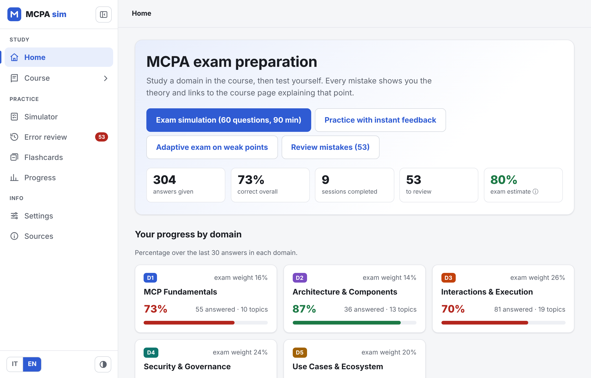
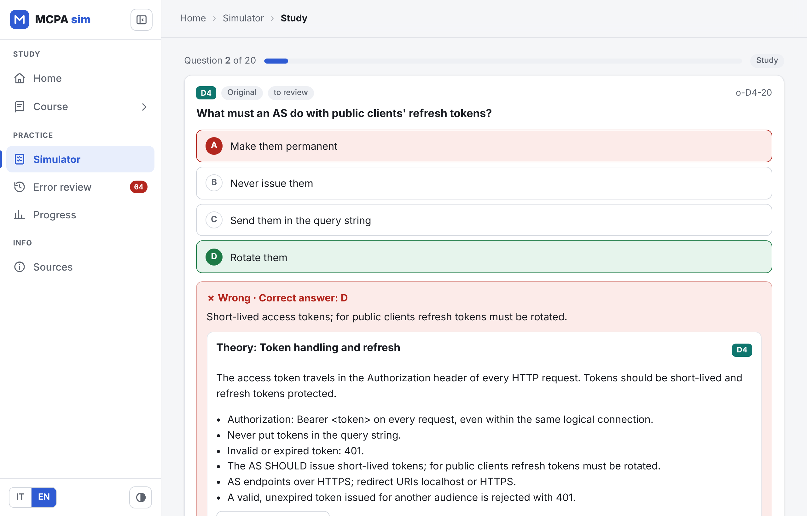
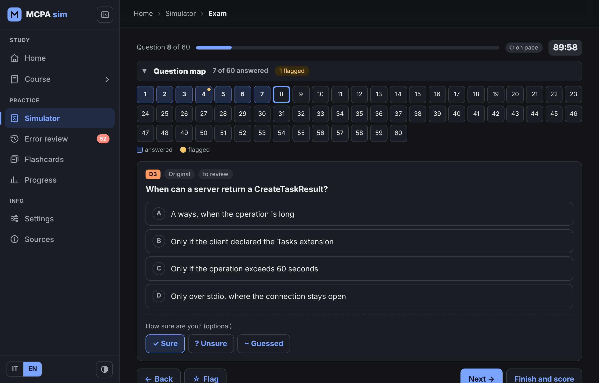
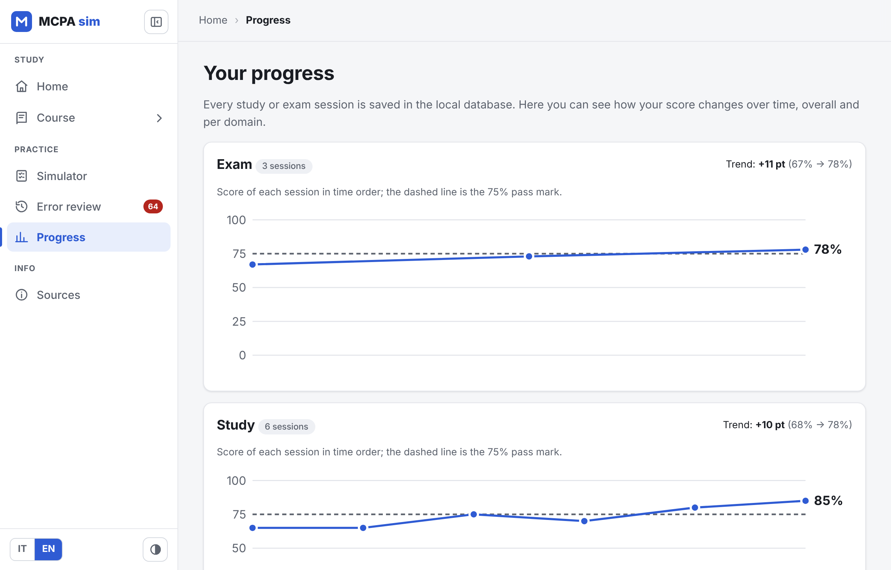
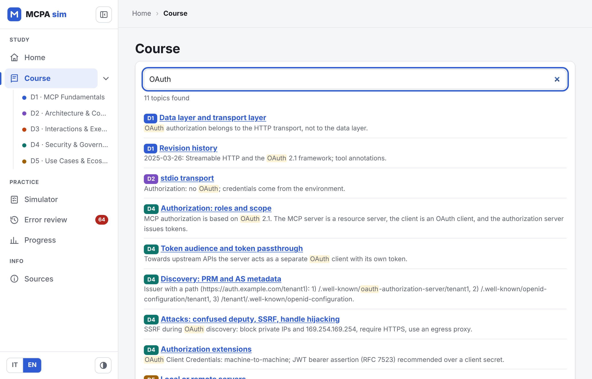
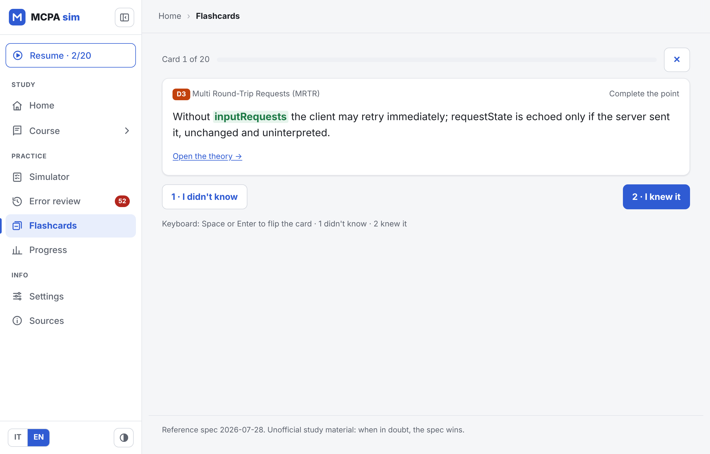
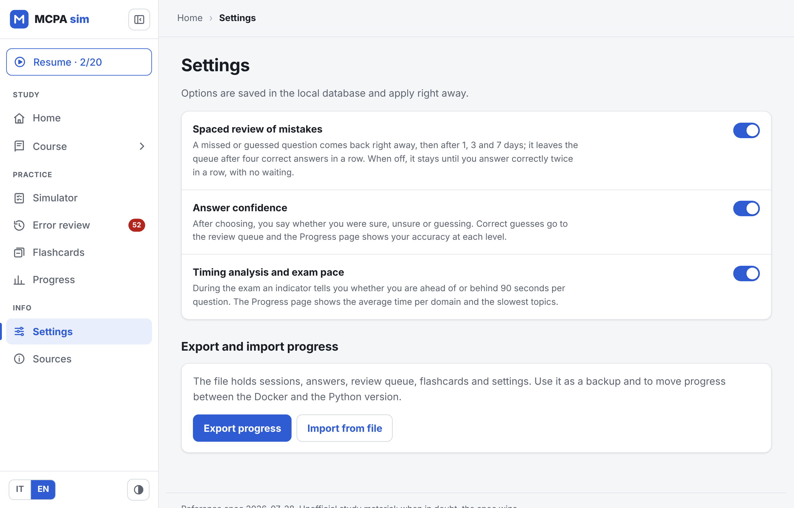

# MCPA Exam Simulator: Model Context Protocol Associate practice tests and course

**English** · [Italiano](README.it.md)

    

A free, open-source **practice exam simulator and study course for the MCPA certification (Model Context Protocol Associate)** from the Linux Foundation and the Agentic AI Foundation (AAIF). It is aligned with the **MCP specification 2026-07-28** (stateless protocol, MRTR, subscriptions/listen, Tasks extension, OAuth authorization).

- **672 practice questions** with explanations, including 60-question / 90-minute **mock exams** weighted by the official exam domains.
- **Course** with 75 topics across the 5 MCPA domains, in **English and Italian**, each linked to the official MCP documentation.
- **Wrong answer? You get the theory** for that topic right away, with a link to the full course page.
- **Progress tracking** in a local SQLite database: score history, per-domain trends, weakest topics, spaced review of mistakes, confidence and timing analysis.
- **Adaptive exam and flashcards** built on your weak points; export and import of your progress from the Settings page.
- Runs locally with **one Docker command** or plain **Python 3** (no dependencies, no account, no tracking).



> Unofficial study material, not affiliated with the Linux Foundation, AAIF or Anthropic. When in doubt, the spec wins. No real exam questions or "dumps" were searched for or used: that would break the LF Certification & Confidentiality Agreement.

---

## Quick start

### With Docker (recommended)
```bash
git clone <this-repo-url>
cd <repo>/site
docker compose up -d --build
```
Open **http://localhost:8765/**. On Windows you can double-click `site/avvia-docker.bat`.

- Your progress lives in the `mcpa-data` volume and survives container rebuilds.
- The port is bound to `127.0.0.1` only, so the site is not reachable from your network.
- Stop with `docker compose down`. `docker compose down -v` also deletes your progress.

### Without Docker
Only **Python 3.8+** is needed, with no extra packages.
```bash
python site/server.py          # opens the browser on http://127.0.0.1:8765
```
On Windows: double-click `site/avvia.bat`.

### First run after `git clone`
The database is not in the repository. On first start `server.py` creates it, applies the SQL migrations in `site/migrations/`, and imports the course and questions from `site/bank.json`. To prepare the database without opening the site: `python site/server.py --migrate`.

---

## Features

| Feature | Details |
|---|---|
| Exam mode | 60 questions, 90-minute timer, question map with flags, scored at the end against a 75% indicative pass mark |
| Study mode | Instant feedback, explanation and the theory of the topic after each answer |
| Question sets | Original (EN/IT), hard scenario questions, rohitg00 MCPA mocks and lesson quizzes (MIT), Hugging Face MCP course (Apache 2.0) |
| Filters and quick start | By domain, difficulty and set; one-click presets (full exam, 10 quick questions, Security & Governance only, hard only) |
| Spaced review | Missed or guessed questions come back today, then after 1, 3 and 7 days, and leave the queue after four correct answers in a row (or two in a row with spaced review off) |
| Answer confidence | After each answer you mark it sure, unsure or guessed: correct guesses still go to review, and Progress shows your accuracy per confidence level |
| Timing and pace | During the exam a pace chip says how far ahead or behind you are against 90 s per question; Progress shows average time per domain and the slowest topics |
| Adaptive exam | 60 questions with the official domain split, picked from questions due for review, recently missed, unseen and from your weakest topics |
| Flashcards | 200 cards generated from the course points (error codes, headers, methods, fields, RFCs, MUST/SHOULD/MAY), starting from weak topics, with Leitner-style repetition |
| Settings | Spaced review, confidence, timing and multiple-answer questions in exam runs can each be switched off (all on by default; LF's public pages do not say whether the real exam has multiple-answer questions); export and import progress as a JSON file, also to move it between Docker and Python |
| Progress | Score over time with the 75% line, per-domain trends, weakest topics, per-session detail with time per question |
| Usability | Light/dark/auto theme, keyboard shortcuts (A–D, Enter, ← →, F), in-progress session survives a page reload, topic search, mobile layout |
| Multi-select | 73 questions ask you to pick more than one answer and always say how many; only the exact combination scores |

| Study mode feedback | Exam mode (dark theme) |
|---|---|
|  |  |
| **Progress charts** | **Course search** |
|  |  |
| **Flashcards** | **Settings and export** |
|  |  |

## The MCPA exam in brief
| | |
|---|---|
| Format | Multiple choice, online, proctored (PSI), one free retake |
| Duration | **90 minutes** (official MCPA page) |
| Questions / pass mark | Not published for MCPA; the general LF rules for multiple-choice exams are **60 questions, 75%** |
| Domains | Interactions & Execution **26%** · Security & Governance **24%** · Use Cases & Ecosystem **20%** · MCP Fundamentals **16%** · Architecture & Components **14%** |

Details and sources: [`sources/exam/lf-exam-page.md`](sources/exam/lf-exam-page.md).

## Question sources
| Set | Count | Language | License / origin |
|---|---|---|---|
| Original | 154 | EN + IT | this project |
| Hard scenarios | 50 | EN + IT | this project |
| rohitg00 / ai-engineering-from-scratch | 414 | EN | MIT |
| Hugging Face MCP course | 23 | EN | Apache 2.0 (pre-2026-07-28, excluded from mock exams) |

You can also add your own questions in `site/local/` (ignored by git, see `site/local/README.md`): the simulator loads them at startup and they never end up in the repository.

Third-party questions were reviewed against the spec; corrections are flagged in the UI and documented in `site/REVISIONE-domande.md`.

## How it works
```
browser ──HTTP──► server.py (Python standard library: http.server + sqlite3)
                     ├── static files: index.html, app.js, app.css
                     ├── JSON API: /api/data, /api/stats, /api/sessions, /api/answers
                     └── SQLite: mcpa.db (or /data/mcpa.db in Docker)
```
- **Frontend:** vanilla JavaScript single-page app, no build step, hand-made SVG charts.
- **Backend:** `server.py`, standard library only, listens on `127.0.0.1`, checks `Host` and `Origin` against DNS rebinding, scores answers server-side, optional password login when deployed online.
- **Content pipeline:** course and questions in `site/content/*.json` → `python site/build/build_data.py` → `site/bank.json`. Run `python site/build/check_consistency.py` to validate structure, EN/IT parity and the database import.
- **Environment variables:** `MCPA_PORT` (8765), `MCPA_BIND` (127.0.0.1), `MCPA_DB`, `MCPA_NO_BROWSER`; for a private online copy `MCPA_PASSWORD` (enables the login) and `MCPA_PUBLIC_HOST`.
- **Online, just for you (optional):** password-protected deploy to Fly.io (`site/fly.toml`) or Render free (`render.yaml`, kept awake by an UptimeRobot check on `/healthz`; save progress with export/import). Step-by-step guide (Italian) in [`DEPLOY.md`](DEPLOY.md). Local use stays password-free.

## Knowledge base
The repository also contains the study notes and official sources the course was built from: `notes/` (Italian study notes per domain, cheat sheets, glossary, exam traps), `sources/` (snapshot of the MCP spec 2026-07-28 and 2025-11-25, SEPs, docs, extensions, registry) and `knowledge/manifest.json` (domains → competencies → topics → key facts → sources).

## Contributing
Found a wrong answer or an outdated fact? Open an issue with the question id and the spec section that proves it. See [`CONTRIBUTING.md`](CONTRIBUTING.md).

## License
Code and original content are released under the **MIT license** ([`LICENSE`](LICENSE)). Third-party material keeps its own license: MCP project files under `sources/` (Apache 2.0 for specs and code, CC BY 4.0 for docs), `practice-questions/open-licensed/rohitg00-mcpa/` (MIT), `practice-questions/open-licensed/huggingface-mcp-course/` (Apache 2.0). Full table in [`README.it.md`](README.it.md#licenza).

"Linux Foundation", "MCPA" and "Model Context Protocol" are trademarks of their respective owners, used here for descriptive purposes only.

<sub>Keywords: MCPA exam, Model Context Protocol Associate, MCP certification, MCP practice test, MCP mock exam, Linux Foundation certification, Agentic AI Foundation, AAIF, MCP specification 2026-07-28, MCP study guide.</sub>
